<picture>
  <source media="(prefers-color-scheme: dark)" srcset="./record-dark.svg">
  
</picture>

### Liner notes

I build software, but what I'm really after is **time**. I look for the slow, expensive, frustrating part of someone's day and make it disappear, so they can spend that time on the work only they can do.

Right now that means building **[CreativeBuddy](https://creativebuddy.ai)**, an AI studio for content creators, and consulting on AI systems for major law firms and lending institutions. Different industries, same job: solve the hard problem, untangle the process, and help people innovate.

I ship a lot. The graph below says it better than I can.

**Off the record:** hiking, running, boxing, digging through crates for vinyl, chasing the perfect cup of coffee, long drives, and home time with my wife and our cats.

Let's talk &#8594; [LinkedIn](https://www.linkedin.com/in/tyler-fritz-83a12477/) &#183; [creativebuddy.ai](https://creativebuddy.ai)

&#169; 2026 Tyler Fritz. Original design and artwork. All rights reserved.
